# [📈 Live Status](https://status.increazy.com): <!--live status--> **Todos os sistemas operando normalmente**

This repository contains the open-source uptime monitor and status page for [increazy](https://status.increazy.com), powered by [Upptime](https://github.com/upptime/upptime).

With [Upptime](https://upptime.js.org), you can get your own unlimited and free uptime monitor and status page, powered entirely by a GitHub repository. We use [Issues](https://github.com/increazy/status/issues) as incident reports, [Actions](https://github.com/increazy/status/actions) as uptime monitors, and [Pages](https://status.increazy.com) for the status page.

<!--start: status pages-->
<!-- This summary is generated by Upptime (https://github.com/upptime/upptime) -->
<!-- Do not edit this manually, your changes will be overwritten -->
<!-- prettier-ignore -->
| URL | Status | History | Response Time | Uptime |
| --- | ------ | ------- | ------------- | ------ |
|  [Lojas](https://increazy.com/healthz) | No ar | [lojas.yml](https://github.com/increazy/status/commits/HEAD/history/lojas.yml) | 

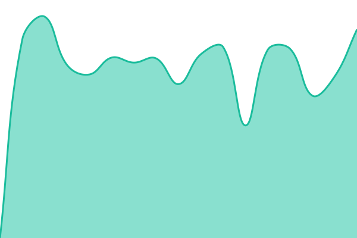 1439ms
     
 | 

<a href="https://status.increazy.com/history/lojas">100.00%</a>
    

|  [Checkout plug & play](https://checkout.app.increazy.com/increazy-ux/) | No ar | [checkout-plug-and-play.yml](https://github.com/increazy/status/commits/HEAD/history/checkout-plug-and-play.yml) | 

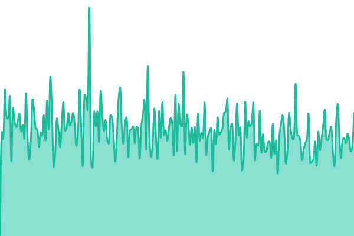 348ms
     
 | 

<a href="https://status.increazy.com/history/checkout-plug-and-play">100.00%</a>
    

|  [API da plataforma](https://ecommerce.api.increazy.com/health/ready) | No ar | [api-da-plataforma.yml](https://github.com/increazy/status/commits/HEAD/history/api-da-plataforma.yml) | 

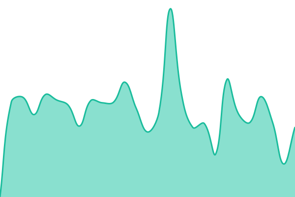 777ms
     
 | 

<a href="https://status.increazy.com/history/api-da-plataforma">100.00%</a>
    

|  [API de pagamentos](https://payment.api.increazy.com/health/ready) | No ar | [api-de-pagamentos.yml](https://github.com/increazy/status/commits/HEAD/history/api-de-pagamentos.yml) | 

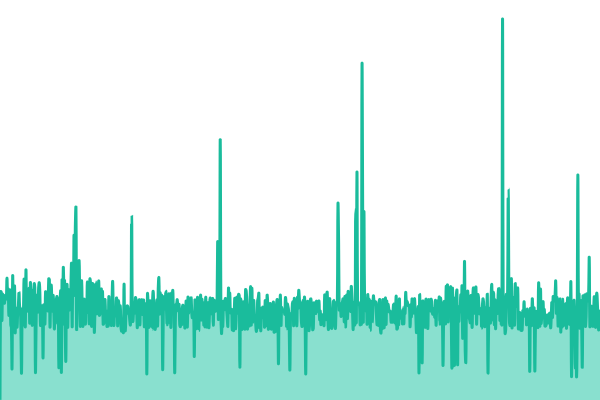 798ms
     
 | 

<a href="https://status.increazy.com/history/api-de-pagamentos">100.00%</a>
    

|  [API de sincronização](https://indexer.api.increazy.com/health/ready) | No ar | [api-de-sincronizacao.yml](https://github.com/increazy/status/commits/HEAD/history/api-de-sincronizacao.yml) | 

 792ms
     
 | 

<a href="https://status.increazy.com/history/api-de-sincronizacao">100.00%</a>
    

|  [API do checkout](https://checkout.api.increazy.com/health/ready) | No ar | [api-do-checkout.yml](https://github.com/increazy/status/commits/HEAD/history/api-do-checkout.yml) | 

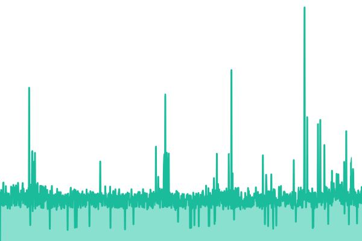 801ms
     
 | 

<a href="https://status.increazy.com/history/api-do-checkout">100.00%</a>
    

|  [API de conexões](https://connect.api.increazy.com/health/ready) | No ar | [api-de-conexoes.yml](https://github.com/increazy/status/commits/HEAD/history/api-de-conexoes.yml) | 

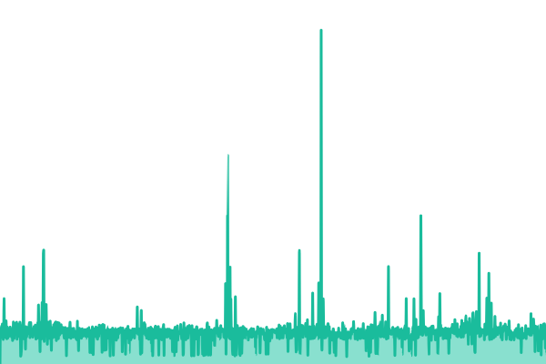 785ms
     
 | 

<a href="https://status.increazy.com/history/api-de-conexoes">100.00%</a>
    

|  [API do painel](https://dash.api.increazy.com/health/ready) | No ar | [api-do-painel.yml](https://github.com/increazy/status/commits/HEAD/history/api-do-painel.yml) | 

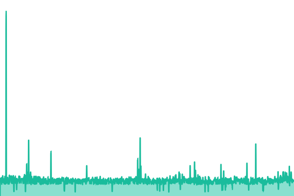 807ms
     
 | 

<a href="https://status.increazy.com/history/api-do-painel">100.00%</a>
    

|  [API de métricas](https://analytics.api.increazy.com/health/ready) | No ar | [api-de-metricas.yml](https://github.com/increazy/status/commits/HEAD/history/api-de-metricas.yml) | 

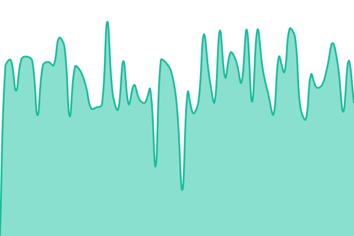 787ms
     
 | 

<a href="https://status.increazy.com/history/api-de-metricas">100.00%</a>
    

|  [API de scraper](https://webscraper.increazy.com/healthz) | No ar | [api-de-scraper.yml](https://github.com/increazy/status/commits/HEAD/history/api-de-scraper.yml) | 

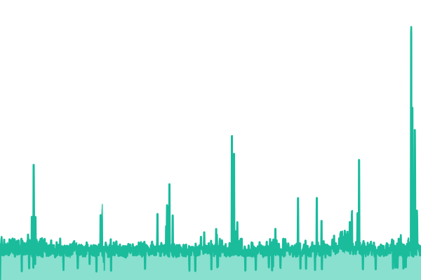 782ms
     
 | 

<a href="https://status.increazy.com/history/api-de-scraper">100.00%</a>
    

|  [Minha conta plug & play](https://account.app.increazy.com) | No ar | [minha-conta-plug-and-play.yml](https://github.com/increazy/status/commits/HEAD/history/minha-conta-plug-and-play.yml) | 

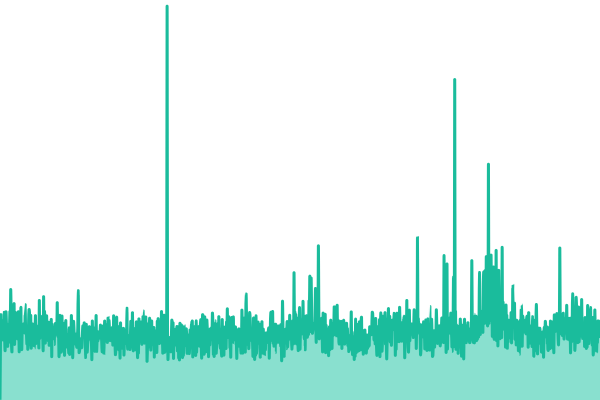 295ms
     
 | 

<a href="https://status.increazy.com/history/minha-conta-plug-and-play">100.00%</a>
    

|  [Painel](https://dashboard.increazy.com) | No ar | [painel.yml](https://github.com/increazy/status/commits/HEAD/history/painel.yml) | 

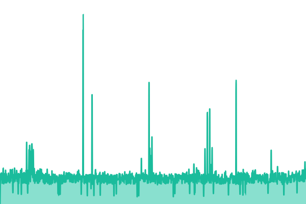 795ms
     
 | 

<a href="https://status.increazy.com/history/painel">100.00%</a>
    

|  [Scripts](https://storage.increazy.com/scripts/checkout.js) | No ar | [scripts.yml](https://github.com/increazy/status/commits/HEAD/history/scripts.yml) | 

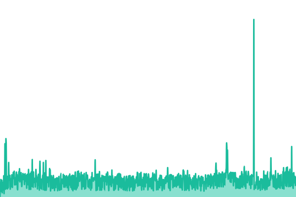 210ms
     
 | 

<a href="https://status.increazy.com/history/scripts">100.00%</a>
    

|  [Documentação](https://docs.increazy.com) | No ar | [documentacao.yml](https://github.com/increazy/status/commits/HEAD/history/documentacao.yml) | 

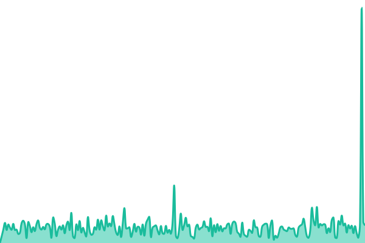 112ms
     
 | 

<a href="https://status.increazy.com/history/documentacao">100.00%</a>
    

<!--end: status pages-->

[**Visit our status website →**](https://status.increazy.com)

## 📄 License

- Powered by: [Upptime](https://github.com/upptime/upptime)
- Code: [MIT](./LICENSE) © [Anand Chowdhary](https://anandchowdhary.com)
- Data in the `./history` directory: [Open Database License](https://opendatacommons.org/licenses/odbl/1-0/)
